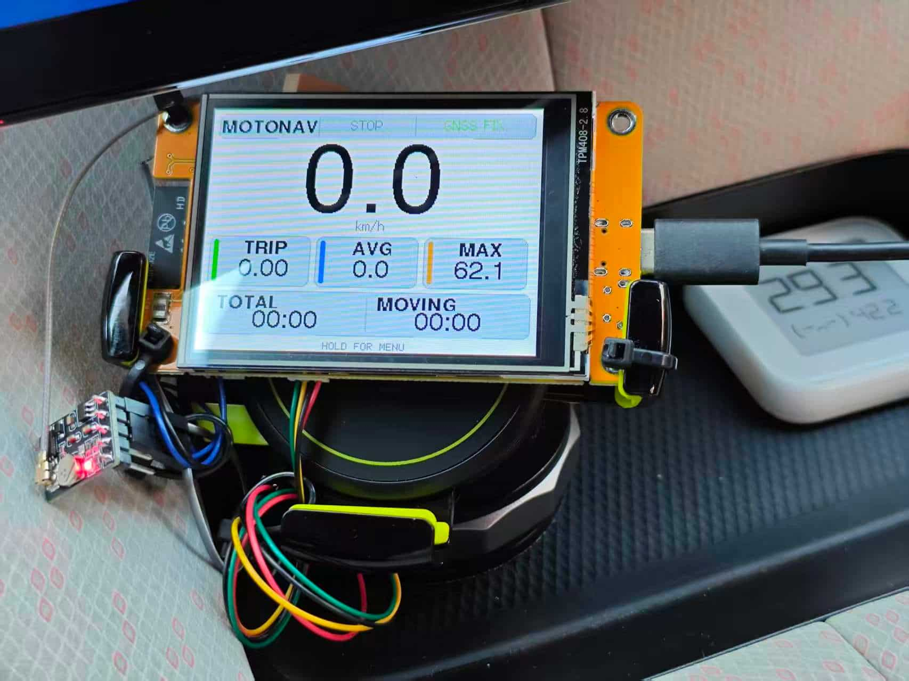

# MotoNav-CYD-Plus

**基于开源项目 [MotoNav-CYD](https://github.com/markseder/MotoNav-CYD) V1.1.2 二次开发的 GPS 摩托车车速表 / 行车电脑 / GPX 记录仪，针对 ESP32-2432S028R「CYD2USB（ST7789 屏）」做了硬件适配与功能扩展。**

核心改动：适配 ST7789 屏幕（修反色）、加装 BMP280 气压计实现海拔/坡度/温度显示、表盘上限提高到 240 km/h、三色速度分区、断电自动补统计、GPX 数据异常防护、文件命名固定东八区、**WiFi 配网 + GPX 轨迹自动上传**等。

## 使用截图



## 复刻价格指导

1. ESP32-2432S028R / CYD 开发版 48 元
2. ATGM336H GNSS 模块 17.43 元
3. BMP280 气压传感器模块 5.6 元

总的 71.03 元。

我做了一个粗糙的 bilibili 视频，喜欢的话给我一键三连哦 🌷 -> [使用ESP32 CYD开发版制作GPS码表](https://www.bilibili.com/video/BV1ZPxn6nEbM/)

---

## 目录

- [项目背景](#项目背景)
- [与上游 V1.1.2 的区别](#与上游-v112-的区别)
- [硬件清单](#硬件清单)
- [接线说明](#接线说明)
- [软件依赖（库）](#软件依赖库)
- [屏幕配置（TFT_eSPI）](#屏幕配置tft_espi)
- [编译与烧录](#编译与烧录)
- [功能清单](#功能清单)
- [操作说明](#操作说明)
- [WiFi 配网与自动上传](#wifi-配网与自动上传)
- [SD 卡文件说明](#sd-卡文件说明)
- [配置常量表](#配置常量表)
- [已知问题与 FAQ](#已知问题与-faq)
- [License](#license)

---

## 项目背景

原作者是给摩托/机车做的开源 GPS 仪表：用一块 ESP32-2432S028R「Cheap Yellow Display（CYD）」外接 GNSS 模块，实现大数字实时车速、行程统计、GPX 轨迹记录等功能。

本改版的使用场景是**燃油车（老车）车内使用**：车主希望在驾驶时一眼看清大字号的实时速度，同时在停车时能记录/查看行驶轨迹与统计。因此对显示做了以下倾向性调整：

- 速度数字足够大，夜间/白天两套主题都高对比；
- 表盘上限从 160 提到 240 km/h（高速公路够用）；
- 加装 BMP280 气压计，补上海拔、坡度、温度三个对长途/山路有帮助的信息；
- 记录过程对断电友好，突然断电也不会丢整段统计。

---

## 与上游 V1.1.2 的区别

| 项目 | 上游 V1.1.2 | 本改版 |
|---|---|---|
| 屏幕 | ILI9341 320×240 | ST7789 240×320（`setRotation(1)` 横屏用） |
| 显示反相 | `invertDisplay(true)` | `invertDisplay(false)`（ST7789 不需要反相） |
| 表盘上限 | 160 km/h | **240 km/h**（MPH 对应 150 mph） |
| 表盘配色 | 单色/红区两段 | **三色分区**：0–60 绿、60–120 蓝、>120 红 |
| 单位文字 | 强调色 | **中性灰**（不随速度分区变色） |
| 气压计 | 无 | **BMP280（I2C）**，海拔/坡度/温度 |
| 海拔数据 | 纯 GNSS | **GNSS 绝对基准慢锚定 + 气压相对变化融合** |
| 坡度显示 | 无 | **百分比 / 角度 / 关闭** 三档；时间域 Vz/Vh 回归，停车冻结显示 |
| 主题切换 | 短按主屏切换日夜 | **移到设置里显式切换**，短按改为切屏 |
| 屏幕切换 | 靠速度自动切换 | **短按手动 TRIP ↔ SPEED**，手动后暂停自动切屏 |
| 文件命名 | UTC | **固定东八区（UTC+8）** |
| 断电恢复 | 只补 GPX 结尾 | **额外重建 CSV 统计并补进历史列表** |
| GPX 海拔 | 直接写 | **数据异常时该点不写 `<ele>`**（保证 GPX 合法） |

详细的实现说明见下文各节。

---

## 硬件清单

| 组件 | 说明 |
|---|---|
| 主控/屏 | ESP32-2432S028R「CYD2USB」双 USB 版，ST7789 240×320 TFT + XPT2046 触摸 + microSD 卡槽 |
| 定位 | 外接 GNSS 模块，输出 NMEA（UART，本改版 9600 baud），接到 GPIO35 |
| 气压计 | BMP280 模块（I2C），用于海拔/坡度/温度 |
| 存储 | FAT32 格式化的 microSD 卡 |
| 电源 | 5V 稳压（**不要直接接车上的 12V**，需经保险丝 + 降压 + 保护） |

> 老车车主装车提示：屏幕选在不妨碍视线、不干扰操控的位置固定；电源一定加保险丝和过压保护，避免点火瞬间浪涌损坏 ESP32。

---

## 接线说明

### GNSS 模块 → CYD

| GNSS 模块 | CYD 引脚 | 用途 |
|---|---:|---|
| TX | GPIO35 | NMEA 数据输入 ESP32 |
| GND | GND | 共地 |
| VCC | 按模块规格 | 先确认模块所需电压（3.3V 或 5V） |
| RX | 不接 | 本固件不向 GNSS 下发指令（`GNSS_TX_PIN = -1`） |

本改版默认 `GNSS_BAUD = 9600`，与你的接收机实际波特率不同时改 `config.h`。

### BMP280 → CYD（I2C）

| BMP280 | CYD 引脚 |
|---|---:|
| VCC | 3.3V |
| GND | GND |
| SDA | **GPIO22** |
| SCL | **GPIO27** |

> 为什么不用默认的 GPIO21/22？因为 GPIO21 被背光（`TFT_BL = 21`）占用，本改版把 I2C 挪到 GPIO22/GPIO27，避开冲突。

BMP280 的 I2C 地址（0x76 / 0x77）会在开机时**自动探测**，无需手动改。模块一般自带 4.7kΩ 上拉，若没有可在 SDA/SCL 各补一只到 3.3V。

---

## 软件依赖（库）

在 Arduino 库目录（Linux 下 `~/Arduino/libraries/`）安装以下库：

| 库 | 版本/说明 |
|---|---|
| `TFT_eSPI` | 屏幕驱动，需配置 `Setup91_MotoNav_CYD.h`（见下节） |
| `TinyGPSPlus` | NMEA 解析 |
| `XPT2046_Touchscreen` | 触摸 |
| `Adafruit_BMP280_Library` | 气压计，v3.0.0 |
| `Adafruit_BusIO` | BMP280 库依赖 |
| `Adafruit_Sensor` | BMP280 库依赖 |

其余 `SD`、`FS`、`Preferences`、`Wire`、`SPI` 均为 ESP32 Arduino Core 自带。

> 字体提示：固件使用 TFT_eSPI 自带的 FreeSansBold 字体（通过 `LOAD_GFXFF` 启用），**不要在 sketch 里重复 `#include` FreeSansBold 头文件**，否则会报重定义错误。

---

## 屏幕配置（TFT_eSPI）

本改版使用 TFT_eSPI 的用户自定义配置 **`Setup91_MotoNav_CYD.h`**，要点如下：

```c
#define ST7789_DRIVER
#define TFT_WIDTH  240
#define TFT_HEIGHT 320

#define TFT_MISO 12
#define TFT_MOSI 13
#define TFT_SCLK 14
#define TFT_CS   15
#define TFT_DC   2
#define TFT_RST  -1      // 此板复位脚未接到 ESP32
#define TFT_BL   21      // 背光 LED
#define TFT_BACKLIGHT_ON HIGH

#define TFT_RGB_ORDER TFT_BGR   // ST7789 面板一般是 BGR 顺序
```

并需在 `User_Setup_Select.h` 中选中 `Setup91_MotoNav_CYD.h`（`#include <User_Setups/Setup91_MotoNav_CYD.h>`）。

> 本仓库已附上该配置文件：`tft_espi_setup/Setup91_MotoNav_CYD.h`。请把它复制到 TFT_eSPI 库的 `User_Setups/` 目录（Linux 下 `~/Arduino/libraries/TFT_eSPI/User_Setups/`），再在 `User_Setup_Select.h` 中取消注释对应 include 行即可。

固件 `setup()` 中关键两行：

```cpp
tft.setRotation(1);        // 240×320 竖屏转成 320×240 横屏
tft.invertDisplay(false);  // ST7789 不需要反相
```

> ⚠️ 这是本改版与上游最关键的区别之一。上游 V1.1.2 面向 ILI9341 屏，写的是 `invertDisplay(true)`；CYD2USB 是 ST7789，若沿用 `true` 会整屏反色（红↔青、绿↔品红、黑↔白全反）。如果你看到「夜间主题却是白底、红色变青色」，就是反相没关。

---

## 编译与烧录

### 方式一：arduino-cli（命令行）

本项目使用 ESP32 板型 `jczn_2432s028r`，并选用 **No OTA（2MB APP）** 分区（WiFi+TLS 体积较大，默认 1.2MB 分区会到 96%）：

```bash
arduino-cli compile --fqbn "esp32:esp32:jczn_2432s028r:PartitionScheme=no_ota" .
arduino-cli upload --fqbn "esp32:esp32:jczn_2432s028r:PartitionScheme=no_ota" -p /dev/ttyUSB0 .
```

（端口号按实际设备改。本项目已用该命令编译通过，约 1.26MB / 60% flash、RAM 18%。）

> 注意：切换分区方案（Default → No OTA）会**清空一次 NVS**，WiFi 凭据与主题/单位等设置需重新配置一次；SD 卡上的行程数据不受影响。

### 方式二：Arduino IDE

1. 在「开发板管理器」安装 **esp32 by Espressif**（本项目编译环境为 ESP32 Arduino Core 3.3.x）。
2. 安装上面列出的库。
3. 配置 TFT_eSPI 的 `Setup91_MotoNav_CYD.h` 并在 `User_Setup_Select.h` 选中它。
4. 打开 `MotoNav-CYD-Plus.ino`，开发板选 `ESP32S3 Dev Module` 或对应的 CYD 板型（本项目对应 `jczn_2432s028r`，即 ESP32-2432S028R），并在「Partition Scheme」里选 **No OTA (2MB APP/2MB SPIFFS)**。
5. 编译上传。

### 开机自检

串口 115200 波特率，上电后应看到：

- `MotoNav-CYD-Plus V1.2.0 Stable`
- `BMP280 ready` ← 气压计正常

若看到 `ERROR: BMP280 not found (check VCC/GND/SDA=22/SCL=27)`，说明气压计没接好或地址不对，但不影响速度/行程/记录等其他功能（海拔会回退到纯 GNSS 数据，坡度/温度显示 `--`）。

---

## 功能清单

### 速度仪表（椭圆表盘）

- 大字号实时车速，横屏居中。
- 表盘上限 **240 km/h**（MPH 模式 **150 mph**，≈241 km/h）。
- **三色速度分区**（刻度数字 + 弧线统一着色）：

  | 速度区间 | 颜色 | 夜间（黑底） | 白天（白底） |
  |---|---|---|---|
  | 0–60 km/h | 绿 | (0,220,70) | (0,140,40) |
  | 60–120 km/h | 蓝 | (90,160,255) | (20,90,200) |
  | >120 km/h | 红 | (255,90,90) | TFT_RED |

- 底部单位 `KM/h` / `MPH` 用**中性灰**，不随分区变色。
- MPH 模式下分区阈值按 60/120 km/h 换算，自动映射（例：75 mph ≈ 120.7 km/h 刚好越过 120，显示为红）。

### 海拔 / 坡度 / 温度（BMP280）

- **温度**：右上角（°C）。
- **海拔**：左下角（米）。
- **坡度**：右下角，三种风格（设置里切换）：
  - `PERCENT`（百分比，默认）
  - `DEGREES`（角度 °）
  - `OFF`（关闭）
- 坡度算法：对「最近约 15 秒内的融合海拔」做时间域最小二乘回归求垂直速度 Vz，再除以水平速度 Vh（多普勒地速）得坡度，整数显示（正数不带 `+`、负数带 `-`、零无号，对齐比亚迪车机观感）。**停车/低速时冻结显示最后一段的值**（近似「坡道驻车仍显示坡度」；精度约 ±0.5~1°，显示的是最近一段道路的坡度，不是车身此刻倾角）。
- 海拔采用 **「GNSS 绝对基准慢锚定 + 气压相对变化」融合**：气压算出的相对海拔变化更平滑、更即时，GNSS 绝对海拔只做慢速校正偏移。定位良好后才锚定；未锚定时回退到纯 GNSS 海拔。
- **数据校验**（I2C 偶发干扰防护）：温度超出 -50~+100°C、海拔超出 -1000~+10000m、或 NaN/Inf，整次采样丢弃，显示 `--`，不污染滤波状态。

### 行程 / 记录

- 行程距离、平均速度、最高速度；总时长、移动时长、停车时长。
- 手动 GPX 记录（`TRACK → START TRACK`），记录到 microSD。
- 每段行程一个 `.CSV` 统计 + 统一 `RIDES_INDEX.CSV` 索引。
- 设备内可浏览最近 **20 条** 行程（RIDES）。
- 速度尖峰、距离跳变、非法 GPX 点过滤。
- 突然断电后，未闭合的 GPX 会被自动补上结尾。
- **断电自动补统计**：记录过程中每 10 秒把累计统计快照写到 `/ACTIVE_STATS.CSV`；断电后下次开机自动重建 `.CSV` 统计并补进 `RIDES_INDEX.CSV`，让这条行程出现在历史列表。

### 主题 / 单位 / 其他

- 白天 / 夜间两套主题（设置里显式切换，保存到 Preferences）。
- 单位：km/h + km 或 mph + mi。
- GNSS 实时诊断：卫星数、HDOP、定位年龄、海拔、经纬度。
- 开机像素风动画 + `READY TO RIDE` 画面。
- FreeSansBold 字体 + 卡片式 UI。

---

## 操作说明

| 动作 | 结果 |
|---|---|
| 驾驶屏**短按** | 在 **行程屏（TRIP）↔ 椭圆速度仪表屏（SPEED）** 之间手动切换；切换后进入手动模式，暂停自动切屏 |
| 停车时**长按约 1.5 秒** | 打开菜单（MENU） |
| `TRACK → START TRACK` | 开始一段 GPX 记录 |
| `TRACK → FINISH` | 结束并保存行程（长按/确认后） |
| `RIDES` | 浏览最近的行程摘要 |
| `GNSS` | 打开实时 GNSS 诊断 |
| `SETTINGS` | 切换主题 / 单位 / 坡度风格 |

**菜单 / 设置 / 诊断 / 历史 / 结束画面** 在车速 ≥ 5 km/h 时自动关闭，并切回大速度表（安全设计，避免行车时看菜单）。

### 设置页（SETTINGS）三个选项

| 按钮 | 功能 |
|---|---|
| `THEME` | 白天 / 夜间 切换 |
| `UNITS` | KM/H / KM ↔ MPH / MI 切换 |
| `GRADE` | 坡度风格 `PERCENT → DEGREES → OFF` 循环 |

设置即时保存到 Preferences，重启后保留。

### 停止记录确认弹窗（STOP RECORD?）

记录过程中停车约 15 秒后，会弹出红色 `STOP RECORD?` 确认屏，防止误触或忘记停止：

- **短按**：返回驾驶屏，**不停止记录**（若仍静止，稍后会再次提醒）；
- **长按**：确认停止记录并保存。

---

## WiFi 配网与自动上传

开机后自动连入已保存的手机热点（**仅 2.4GHz**，手机热点务必选 2.4GHz 频段，否则连不上）；连不上则开一个**无密码**热点 `MotoNav-AP`，手机连上后浏览器打开任意页面（或访问网关 IP）即可配网。最终目的是让板子联网，用于 GPX 自动上传。

- **上传端点**：`POST https://tracks.example.com/api/ingest`（占位示例，需自部署或自行填写），认证头 `X-API-Key`，multipart 字段名 `file`。
- **WebDAV 上传（可选）**：在 `secret.h` 里填 `WEBDAV_SERVER_URL` / `WEBDAV_USERNAME` / `WEBDAV_PASSWORD` 三项后，同一批行程会额外以 HTTP `PUT` 上传到该目录（`<目录>/<文件名>.GPX`，Basic 认证）。与 TRACKS 上传并存，互不影响；只传 GPX，CSV 从不参与。
- **API Key**：写入 `secret.h` 的 `TRACKS_API_KEY`（`secret.h` 已加入 `.gitignore`，模板见 `secret.h.example`）。服务端按内容 SHA-256 去重，重复上传返回 `200` 也算成功。
- **开关**：设置页第 2 页有 `AUTO UPLOAD` 开关；开启后，在**联网 + 有待上传行程**时后台以「批次」模型上传（开机连上后 / 每次行程结束后 / 失败后每 5 分钟重试）：触发时**一次性抓取全部待上传文件**，逐个流式上传；一条文件需向**所有已配置目标**都成功才置 `uploaded=1`，失败的保持 `0`（本批不立即重试，留给下一周期）。
- **结果推送（ntfy）**：整批上传完（只要实际尝试过）就推送**一条** ntfy 通知，无论成功/失败都推，正文按已配置目标分别报「成功 n 条，失败 m 条」（如 `tracks成功2条失败0条；webdav成功2条失败0条`）。服务器/主题在 `secret.h` 配置：`NTFY_SH_SERVER`（默认官方 `https://ntfy.sh`）、`NTFY_SH_PUSH_TOPIC`（默认 `cyd_gpx_auto_upload_notify`）；手机装 ntfy App 订阅同名主题即可收到。全部目标无失败 `priority=3`，任一有失败 `priority=4`。
- **忽略某条行程**：在「RIDES」历史里**长按**当前行程，在「已忽略 / 待上传」间切换（`uploaded` 置 `2`）；点标题栏返回菜单。
- **证书校验**：内置 Let's Encrypt 根证书 `ISRG Root X1` 校验服务器（上传与 ntfy 均校验），不跳过 TLS。

---

## SD 卡文件说明

| 文件 | 说明 |
|---|---|
| `TRK_YYYYMMDD_HHMMSS.GPX` | 轨迹文件（文件名用**东八区**本地时间） |
| `TRK_YYYYMMDD_HHMMSS.CSV` | 对应一段行程的统计（与 GPX 同名） |
| `RIDES_INDEX.CSV` | 全部行程的紧凑索引，供设备内历史列表读取；每行末尾带 `uploaded` 字段（0=待上传 / 1=已上传 / 2=已忽略） |
| `ACTIVE_TRACK.TXT` | 临时恢复标记（记录中）——正常结束会删除；记录了当前 GPX 文件名 |
| `ACTIVE_STATS.CSV` | 记录中的统计快照（每 10 秒更新），断电后用于自动补统计——正常结束会删除 |

**GPX 结构**：标准 GPX 1.1，`<trkpt lat= lon=>` 每点带 `<time>`（UTC，`...Z`），海拔 `<ele>` 只在数值合理时写入（见「数据校验」）。可在 QGIS、Google Earth Pro、GPXSee、OsmAnd 等工具中打开。

**断电恢复流程**：
1. 记录中 → `ACTIVE_TRACK.TXT` 存当前 GPX 文件名，`ACTIVE_STATS.CSV` 每 10 秒存累计统计。
2. 突然断电。
3. 下次开机 → 读到 `ACTIVE_TRACK.TXT`，给未闭合 GPX 补结尾；再读 `ACTIVE_STATS.CSV`，重建 `.CSV` 统计 + 补 `RIDES_INDEX.CSV` 一行。
4. 正常停止记录时两个临时文件都会被删除。

> 恢复精度：断电瞬间最多丢失最后 10 秒内的增量（主要是总时长、以及最后 10 秒还在移动的距离）。停稳后再断电基本无损。

---

## 配置常量表

以下常量集中在 `config.h`，改动后重新编译即可。

### 引脚

| 常量 | 值 | 说明 |
|---|---:|---|
| `GNSS_RX_PIN` | 35 | GNSS NMEA 输入 |
| `GNSS_TX_PIN` | -1 | 不向 GNSS 下发指令 |
| `GNSS_BAUD` | 9600 | GNSS 波特率 |
| `TOUCH_CS_PIN` / `TOUCH_IRQ_PIN` | 33 / 36 | 触摸 |
| `TOUCH_MOSI/MISO/CLK` | 32 / 39 / 25 | 触摸 SPI |
| `SD_CS/SCK/MISO/MOSI` | 5 / 18 / 19 / 23 | microSD SPI |
| `I2C_SDA_PIN` | 22 | BMP280 SDA |
| `I2C_SCL_PIN` | 27 | BMP280 SCL |
| `BMP280_ADDR` / `BMP280_ADDR_ALT` | 0x76 / 0x77 | 自动探测 |

### 速度 / 行程

| 常量 | 值 | 说明 |
|---|---:|---|
| `GAUGE_MAX_KMH` | 240 | 表盘上限（km/h） |
| `GAUGE_MAX_MPH` | 150 | 表盘上限（mph） |
| `MAX_VALID_SPEED_KMH` | 220 | 超过视为非法速度 |
| `MAX_HDOP_FOR_DISTANCE` / `MAX_HDOP_FOR_TRACK` | 4.0 / 5.0 | HDOP 过滤 |
| `MIN_SATELLITES_FOR_TRACK` | 4 | 最少卫星数 |
| `MIN_TRACK_POINT_DISTANCE_M` | 1.5 | 最小轨迹点间距 |
| `MAX_TRACK_SEGMENT_DISTANCE_M` | 100 | 最大轨迹段距离 |
| `TRACK_POINT_INTERVAL_MS` | 1000 | 轨迹点间隔 |
| `SPEED_SCREEN_ENTER_KMH` / `EXIT_KMH` | 5.0 / 1.0 | 自动切屏阈值 |
| `MENU_AUTO_CLOSE_SPEED_KMH` | 5.0 | 车速高于此自动关菜单 |
| `SPEED_FILTER_ALPHA_LOW` / `_NORMAL` | 0.22 / 0.38 | 速度 EMA 系数（低速 / 正常） |
| `SPEED_FILTER_ALPHA_FALL` | 0.5 | 减速方向 EMA 系数（更快归零） |
| `SPEED_NOISE_FLOOR_KMH` | 0.8 | 显示归零的噪声底 |
| `SPEED_STOP_THRESHOLD_KMH` | 1.0 | 疑似静止判定阈值 |
| `SPEED_STOP_RESUME_KMH` | 2.5 | 静止恢复阈值（迟滞） |
| `SPEED_STOP_HOLD_MS` | 2500 | 连续低速多久判定真正静止 |
| `SPEED_STOP_RESUME_SAMPLES` | 2 | 静止恢复去抖（连续几次超阈值才退出） |

### BMP280 / 海拔 / 坡度

| 常量 | 值 | 说明 |
|---|---:|---|
| `SEA_LEVEL_HPA` | 1013.25 | 相对海拔参考气压 |
| `TEMP_OFFSET_C` | 0.0 | 温度补偿（发现系统性偏差再改） |
| `BARO_READ_INTERVAL_MS` | 100 | 采样周期 |
| `BARO_ALT_ALPHA` | 0.15 | 海拔低通系数 |
| `BARO_GNSS_ANCHOR_ALPHA` | 0.01 | GNSS 绝对海拔慢锚定系数 |
| `GRADE_WINDOW_S` | 15.0 | Vz 回归窗口（秒，越大越稳、越滞后） |
| `GRADE_SAMPLE_INTERVAL_MS` | 250 | 海拔采样周期（4 Hz） |
| `GRADE_MIN_VH_KMH` | 3.0 | 水平速度门控，低于此值冻结坡度 |
| `GRADE_MIN_SAMPLES` | 8 | 窗口内最少采样点数 |
| `GRADE_MAX_PERCENT` | 40.0 | 坡度物理限幅（超出丢弃） |
| `GRADE_OUTPUT_ALPHA` | 0.25 | 输出坡度 EMA 平滑系数 |
| `BARO_MIN_TEMP_C` / `BARO_MAX_TEMP_C` | -50 / 100 | 温度合理范围（超出丢弃） |
| `ALT_MIN_M` / `ALT_MAX_M` | -1000 / 10000 | 海拔合理范围（超出丢弃） |
| `STATS_SNAPSHOT_INTERVAL_MS` | 10000 | 断电恢复快照间隔 |

---

## 已知问题与 FAQ

### 1. 屏幕上颜色是反的（夜间像白天、红变青）
本改版已把 `tft.invertDisplay(false)` 写对（ST7789）。若仍反色，检查 TFT_eSPI 是否真的选中了 `Setup91_MotoNav_CYD.h`（`User_Setup_Select.h`），或面板是否是 BGR 顺序（`TFT_RGB_ORDER TFT_BGR`）。

### 2. 海拔出现 2147483647、坡度 `-nan°`、温度 182°
不是传感器坏了，是 **I2C 偶发干扰**读到了垃圾值。本改版已在采样层做合理性校验（温度/海拔超范围、NaN/Inf 整次丢弃），显示层兜底为 `--`，GPX 层异常时**不写 `<ele>`**，保证 GPX 合法可导入。若 `--` 出现频繁，说明线路噪声偏大，建议：SDA/SCL 尽量短、双绞，远离点火/大电流线束，必要时补 4.7kΩ 上拉。

### 3. 开机提示 `ERROR: BMP280 not found`
检查 VCC/GND/SDA=22/SCL=27 是否接对；确认地址 0x76 或 0x77。未检测到 BMP280 时其余功能正常，只是海拔回退纯 GNSS、坡度/温度显示 `--`。

### 4. 断电后行程会不会丢？
不会。记录中的统计每 10 秒快照一次，断电后开机自动补 `.CSV` 统计并补进历史列表；GPX 结尾也会被自动补上。最多丢失最后 10 秒内的少量增量。

### 5. 文件时间是 UTC 还是本地时间？
本改版文件名、CSV 里的日期/时间列均为**东八区（UTC+8）**本地时间；GPX 内部的 `<time>` 仍是标准 UTC（带 `Z`），符合 GPX 规范。

### 6. 可以一边开车一边看菜单吗？
不建议，也做不到——车速 ≥ 5 km/h 时菜单/设置/诊断会自动关闭并切回速度表。

---

## License

本项目（MotoNav-CYD-Plus）是 [MotoNav-CYD](https://github.com/markseder/MotoNav-CYD)（MIT License，Copyright © 2026 Pavel Matveev）的衍生修改版，以相同的 MIT 许可证发布，详见 [LICENSE](LICENSE)。你可以在保留原作者版权与许可证声明的前提下使用、修改、再分发。

## Credits

- **上游项目**：[markseder/MotoNav-CYD](https://github.com/markseder/MotoNav-CYD)（MIT License，Copyright © 2026 Pavel Matveev）——本项目的硬件方案、仪表 UI 与 GPX 记录框架均基于其 V1.1.2。
- **本改版（MotoNav-CYD-Plus）**：[hellodk34 (hellodk34)](https://github.com/hellodk34) 二次开发——ST7789 / CYD2USB 硬件适配、BMP280 海拔/坡度/温度、表盘上限提升至 240 km/h、WiFi 配网 + GPX 自动上传（TRACKS + WebDAV）与 ntfy 推送等。

> 本改版代码未经原作者背书，请自行评估装车使用风险。

> 安全提示：这是 DIY 项目。装车请务必使用带保险丝的电源、做好过压/浪涌保护、牢固固定并做好防水防震，屏幕安装在不妨碍视线与操控的位置。
